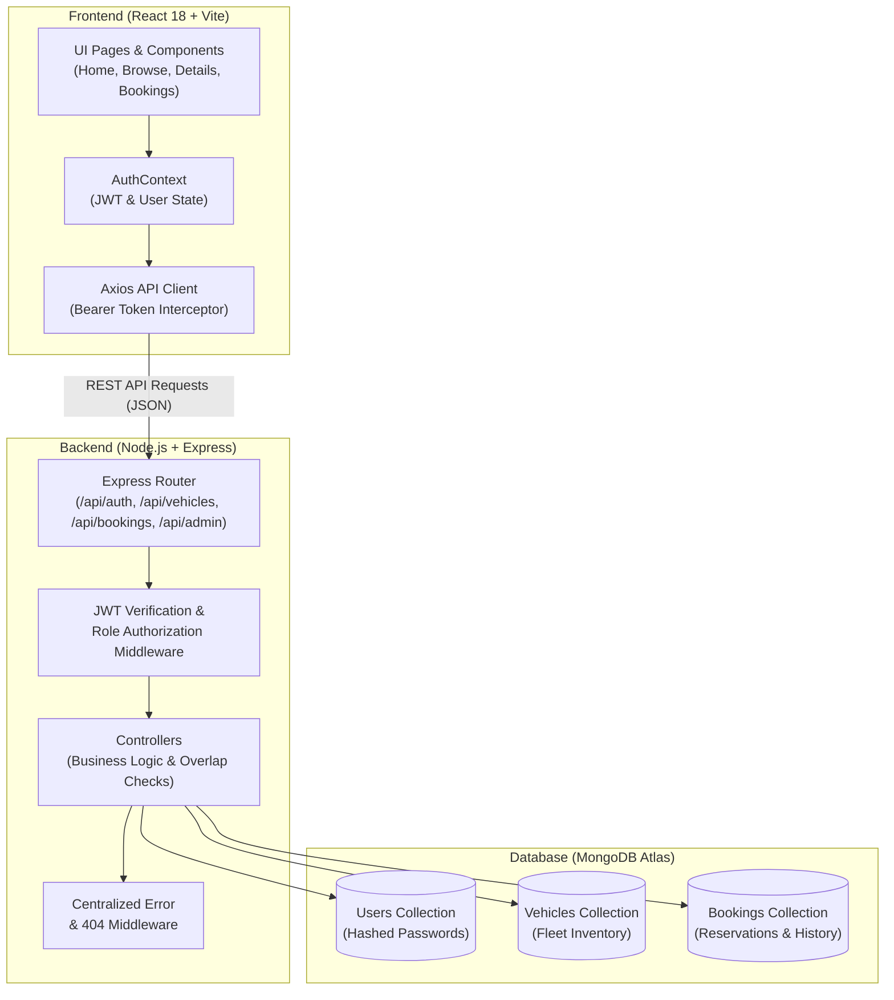
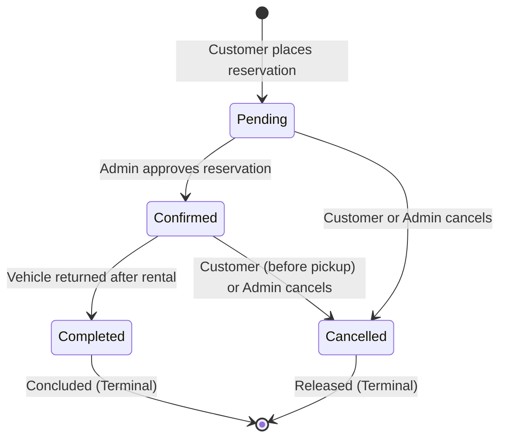

# DriveEase — Vehicle Rental Management System (MERN Stack)

[](https://reactjs.org/)
[](https://vitejs.dev/)
[](LICENSE)
[](#)

---

## 📌 1. Project Overview & Problem Statement

**DriveEase** is an end-to-end, production-ready Vehicle Rental Management System designed and implemented using the **MERN** stack (MongoDB, Express.js, React.js with Vite, and Node.js). It was engineered for a college **Full Stack Development (FSD)** mini-project.

### Problem Statement
Traditional car rental reservation processes often suffer from:
1. **Double-Booking & Scheduling Collisions:** Lack of real-time overlap validation causing two customers to book the same vehicle for overlapping dates.
2. **Untrusted Frontend Calculations:** Insecure architectures calculating total costs on the client side, allowing malicious users to manipulate network payloads.
3. **Price Inconsistency:** Changing a vehicle's current daily rate retroactively changes historical invoice totals for past bookings.
4. **Poor Administrative Control:** Absence of strict role-based access control (RBAC), leaving admin dashboards vulnerable to unauthorized access.

### Solution
DriveEase resolves these challenges through:
- **Server-Side Date Conflict Detection:** Algorithmic verification rejecting overlapping reservations for `Pending` or `Confirmed` bookings.
- **Server-Calculated Billing:** Rental duration and pricing are computed exclusively on the backend (`rentalDays * pricePerDayAtBooking`).
- **Immutable Historical Pricing:** Vehicle rental prices at the exact time of booking are locked into the booking record.
- **Strict Role-Based Access Control (RBAC):** Express middleware ensuring customer accounts cannot access admin analytics or modify fleet records.

---

## 🏗️ 2. System Architecture



---

## ✨ 3. Core Features

### 👤 Customer Features
- **User Authentication:** Registration with validation, duplicate email prevention, password hashing with `bcryptjs`, and stateless JWT authentication.
- **Fleet Catalog:** Browse vehicles with dynamic filtering by:
  - Category (Hatchback, Sedan, SUV, Electric, Luxury)
  - Fuel Type (Petrol, Diesel, Electric, Hybrid)
  - Transmission (Manual, Automatic)
  - Daily Price Sorting (Low-to-High, High-to-Low)
  - Date-Based Availability (Excludes vehicles booked during specified dates)
- **Detailed Specifications:** High-resolution car imagery, seating capacity, fuel type, transmission, safety badges, and transparent daily pricing in Indian Rupees (₹ INR).
- **Interactive Reservation Engine:**
  - Live rental duration and total cost calculation preview.
  - Conflict prevention checking active reservations.
  - Unique booking reference generation (e.g., `DE-2026-X8K1A`).
  - Safe reservation workflow (no payment gateway simulation; confirmed reservation on arrival).
- **My Bookings Dashboard:** View all personal reservations, track statuses (`Pending`, `Confirmed`, `Completed`, `Cancelled`), and cancel eligible reservations online.
- **User Profile:** Manage profile details (Name, Contact Phone) with email protection.

### 🛡️ Admin Operations
- **Role-Based Access Control (RBAC):** Backend route guards (`protect` and `authorize('admin')`) preventing privilege escalation.
- **Live Operations Dashboard:**
  - Total Fleet Count, Available Fleet, In-Maintenance Vehicles.
  - Total Bookings, Pending Approvals, Confirmed Trips, Completed Rentals, Cancelled Bookings.
  - Registered Customer Count.
  - Confirmed Gross Revenue (₹ INR) aggregated via MongoDB pipeline.
  - Recent Booking Feed with customer and vehicle details.
- **Vehicle Fleet Management (CRUD):**
  - Add new vehicles with comprehensive validation.
  - Edit existing vehicles (pricing, description, status, specifications).
  - Safe Deletion (prevents deleting vehicles with active or upcoming bookings).
- **Booking Lifecycle Management:**
  - View all customer bookings with status filtering and text search.
  - Approve pending reservations (`Pending` → `Confirmed`).
  - Finalize concluded trips (`Confirmed` → `Completed`).
  - Cancel bookings with administrative audit trail.

---

## 🗄️ 4. Booking Lifecycle & Conflict Logic



### Overlap Detection Formula
A vehicle is marked **unavailable** for a requested window $[\text{Pickup}_{\text{new}}, \text{Return}_{\text{new}}]$ if there exists any active booking for that vehicle with status in `['Pending', 'Confirmed']` satisfying:

$$\text{existing.pickupDate} < \text{Return}_{\text{new}} \quad \text{AND} \quad \text{existing.returnDate} > \text{Pickup}_{\text{new}}$$

---

## 📁 5. Project Directory Structure

```text
DriveEase/
├── client/                      # React Frontend (Vite)
│   ├── public/                  # Static assets & favicon
│   ├── src/
│   │   ├── components/          # Reusable components
│   │   │   ├── AdminRoute.jsx       # Route guard for admin
│   │   │   ├── AlertMessage.jsx     # Notifications & alerts
│   │   │   ├── ConfirmationModal.jsx# Confirmation dialogs
│   │   │   ├── Footer.jsx           # Application footer
│   │   │   ├── LoadingSpinner.jsx   # Async loading state
│   │   │   ├── Navbar.jsx           # Responsive navigation bar
│   │   │   ├── ProtectedRoute.jsx   # Route guard for logged-in users
│   │   │   └── VehicleCard.jsx      # Fleet item display card
│   │   ├── context/
│   │   │   └── AuthContext.jsx      # Global user & auth state
│   │   ├── layouts/
│   │   │   └── AdminLayout.jsx      # Admin sidebar and layout
│   │   ├── pages/
│   │   │   ├── admin/
│   │   │   │   ├── AdminDashboard.jsx # Admin metrics & live stats
│   │   │   │   ├── ManageBookings.jsx # Booking status management
│   │   │   │   └── ManageVehicles.jsx # Fleet CRUD operations
│   │   │   ├── BrowseVehicles.jsx   # Catalog search & filtering
│   │   │   ├── Home.jsx             # Landing page with hero & featured
│   │   │   ├── Login.jsx            # Sign in page + quick demo fill
│   │   │   ├── MyBookings.jsx       # Customer booking history & cancel
│   │   │   ├── NotFound.jsx         # 404 Error page
│   │   │   ├── Profile.jsx          # User profile settings
│   │   │   └── VehicleDetails.jsx   # Full specs & reservation panel
│   │   ├── services/
│   │   │   └── api.js               # Axios instance with JWT interceptor
│   │   ├── App.jsx                  # Main routing configuration
│   │   ├── index.css                # Navy/White design system CSS
│   │   └── main.jsx                 # React DOM mount point
│   ├── .env.example
│   ├── index.html
│   ├── package.json
│   ├── vercel.json              # Vercel SPA routing rewrite
│   └── vite.config.js
│
├── server/                      # Express Backend
│   ├── config/
│   │   └── db.js                # MongoDB Mongoose connection
│   ├── controllers/
│   │   ├── adminController.js   # Analytics & admin booking handlers
│   │   ├── authController.js    # Register, Login, GetMe, UpdateProfile
│   │   ├── bookingController.js # Reservation creation, cancel, my bookings
│   │   └── vehicleController.js # Fleet query, filters, CRUD
│   ├── middleware/
│   │   ├── auth.js              # JWT protection & role authorization
│   │   └── errorMiddleware.js   # Centralized error handler & 404
│   ├── models/
│   │   ├── Booking.js           # Mongoose booking schema
│   │   ├── User.js              # Mongoose user schema with bcrypt
│   │   └── Vehicle.js           # Mongoose vehicle schema
│   ├── routes/
│   │   ├── adminRoutes.js       # Admin endpoints
│   │   ├── authRoutes.js        # Auth endpoints
│   │   ├── bookingRoutes.js     # Booking endpoints
│   │   └── vehicleRoutes.js     # Vehicle endpoints
│   ├── scripts/
│   │   ├── seed.js              # Seeds 9 realistic Indian cars + accounts
│   │   └── verify-api.js        # Automated API & logic test suite
│   ├── utils/
│   │   └── jwt.js               # JWT signing utility
│   ├── .env.example
│   ├── package.json
│   ├── render.yaml              # Render deployment configuration
│   └── server.js                # Express application entrypoint
│
├── .gitignore
├── package.json                 # Root convenience scripts
└── README.md
```

---

## 🚀 6. Installation & Local Setup

### Prerequisites
- **Node.js** (v18 or higher recommended; tested on v22)
- **npm** (v9 or higher)
- **MongoDB Atlas** account (or local MongoDB server)

---

### Step 1: Clone or Navigate to the Repository
```bash
cd vehicle-rental-management-system
```

---

### Step 2: Install Dependencies
You can install dependencies for both frontend and backend using the root script:
```bash
npm run install:all
```
*Or install separately:*
```bash
# In server directory:
cd server && npm install

# In client directory:
cd ../client && npm install
```

---

### Step 3: Configure Environment Variables

#### Backend (`server/.env`):
Create `server/.env` (or copy from `server/.env.example`):
```env
PORT=5000
MONGODB_URI=mongodb+srv://<username>:<password>@cluster0.xxxxxxx.mongodb.net/driveease?retryWrites=true&w=majority
JWT_SECRET=driveease_jwt_secret_secure_key_fsd_mini_project_2026
CLIENT_URL=http://localhost:5173

# Admin Initial Setup (Used by seed script)
ADMIN_NAME=DriveEase Administrator
ADMIN_EMAIL=admin@driveease.com
ADMIN_PASSWORD=Admin@DriveEase2026
ADMIN_PHONE=+91 9876543210
```

> **Important (MongoDB Atlas Setup):**
> 1. Log in to [MongoDB Atlas](https://www.mongodb.com/cloud/atlas).
> 2. Create a Free Shared Cluster (M0).
> 3. Under **Database Access**, create a user with Read & Write privileges.
> 4. Under **Network Access**, click **Add IP Address** and select **Allow Access from Anywhere (`0.0.0.0/0`)**.
> 5. Click **Connect** → **Drivers** (Node.js) → copy your connection string into `MONGODB_URI`.

#### Frontend (`client/.env`):
Create `client/.env` (or copy from `client/.env.example`):
```env
VITE_API_URL=http://localhost:5000/api
```

---

### Step 4: Seed the Database
Run the seed script to automatically insert **9 realistic vehicles** (Tata Nexon EV, Hyundai Creta, Mahindra XUV700, Toyota Fortuner, BMW 3 Series, etc.) and generate sample bookings for live dashboard analytics:
```bash
# From root directory:
npm run seed

# Or inside server directory:
cd server && npm run seed
```

#### Pre-Configured Demo Accounts:
| Role | Email | Password |
|---|---|---|
| **Administrator** | `admin@driveease.com` | `Admin@DriveEase2026` |
| **Demo Customer** | `rahul.sharma@example.com` | `Customer@123` |

*(Note: The login page includes quick-fill buttons for instant testing during project demonstrations!)*

---

### Step 5: Start the Development Servers

Open two terminal windows:

#### Terminal 1 — Backend:
```bash
cd server
npm run dev
# Server runs on http://localhost:5000
```

#### Terminal 2 — Frontend:
```bash
cd client
npm run dev
# Frontend runs on http://localhost:5173
```

Open `http://localhost:5173` in your browser.

---

## 🧪 7. Automated Testing & Verification

Run the included automated verification suite:
```bash
cd server
npm test
```
The test suite validates:
1. JWT token generation, payload signing, and verification.
2. Role-Based Access Control (RBAC) blocking unauthorized customer requests on admin routes.
3. Accurate server-side rental days and pricing calculation.
4. Mathematical overlap conflict detection formula across date edge cases.
5. Strict booking lifecycle state transitions (`Pending` → `Confirmed` → `Completed`).
6. Security enforcement preventing password hash exposure in User JSON returns.

---

## 📡 8. REST API Documentation

### Base URL: `/api`

### Authentication (`/api/auth`)
| Method | Endpoint | Access | Description | Request Body |
|---|---|---|---|---|
| `POST` | `/api/auth/register` | Public | Register customer account | `{ name, email, phone, password }` |
| `POST` | `/api/auth/login` | Public | Authenticate user & get JWT | `{ email, password }` |
| `GET` | `/api/auth/me` | Authenticated | Retrieve current user profile | Header `Authorization: Bearer <token>` |
| `PUT` | `/api/auth/me` | Authenticated | Update user name / phone | `{ name, phone }` |

### Vehicles (`/api/vehicles`)
| Method | Endpoint | Access | Description | Query / Body |
|---|---|---|---|---|
| `GET` | `/api/vehicles` | Public | List fleet with search & filters | `?search=&category=&fuelType=&transmission=&pickupDate=&returnDate=` |
| `GET` | `/api/vehicles/:id` | Public | Get single vehicle details | ID in URL param |
| `POST` | `/api/vehicles` | Admin | Add new vehicle | `{ name, brand, category, image, description, pricePerDay, fuelType, transmission, seats, registrationNumber }` |
| `PUT` | `/api/vehicles/:id` | Admin | Update vehicle info | Fields to update |
| `DELETE` | `/api/vehicles/:id` | Admin | Safe archive/delete vehicle | Rejects if active bookings exist |

### Bookings (`/api/bookings`)
| Method | Endpoint | Access | Description | Request Body |
|---|---|---|---|---|
| `POST` | `/api/bookings` | Customer | Create reservation | `{ vehicleId, pickupDate, returnDate, notes }` |
| `GET` | `/api/bookings/my` | Customer | Get user's reservations | Sorted newest first |
| `GET` | `/api/bookings/:id` | Owner/Admin| Get single reservation | ID in URL param |
| `PATCH`| `/api/bookings/:id/cancel`| Owner/Admin| Cancel upcoming reservation| `{ reason }` |

### Admin Operations (`/api/admin`)
| Method | Endpoint | Access | Description |
|---|---|---|---|
| `GET` | `/api/admin/stats` | Admin | Aggregated metrics, revenue, category stats, recent activity |
| `GET` | `/api/admin/bookings` | Admin | All customer reservations with search and status filter |
| `PATCH`| `/api/admin/bookings/:id/status`| Admin | Transition status (`Pending` → `Confirmed`, `Confirmed` → `Completed`, `Cancelled`) |
| `GET` | `/api/admin/users` | Admin | List registered customers and booking count |

### Health Check
- `GET /api/health` — Returns application status, uptime, and MongoDB connectivity state.

---

## 🌐 9. Free-Tier Deployment Guide

### A. Database: MongoDB Atlas (Free M0 Cluster)
1. Deploy a free cluster at [mongodb.com/cloud/atlas](https://www.mongodb.com/cloud/atlas).
2. Set Network Access to `0.0.0.0/0`.
3. Create a database user and obtain the connection string.

### B. Backend: Render (Free Web Service)
1. Push your repository to GitHub.
2. Sign up on [Render.com](https://render.com).
3. Click **New** → **Web Service** → Connect your GitHub repository.
4. Settings:
   - **Root Directory:** `server`
   - **Environment:** `Node`
   - **Build Command:** `npm install`
   - **Start Command:** `node server.js`
5. Environment Variables in Render:
   - `PORT`: `5000`
   - `NODE_ENV`: `production`
   - `MONGODB_URI`: `<Your MongoDB Atlas Connection String>`
   - `JWT_SECRET`: `<Your Secret Key>`
   - `CLIENT_URL`: `<Your Vercel URL, e.g. https://driveease.vercel.app>`
6. Deploy and copy your Render service URL (e.g., `https://driveease-api.onrender.com`).

### C. Frontend: Vercel (Free Hobby Tier)
1. Sign up on [Vercel.com](https://vercel.com).
2. Click **Add New** → **Project** → Import your repository.
3. Settings:
   - **Framework Preset:** Vite
   - **Root Directory:** `client`
   - **Build Command:** `npm run build`
   - **Output Directory:** `dist`
4. Environment Variables in Vercel:
   - `VITE_API_URL`: `https://driveease-api.onrender.com/api`
5. Click **Deploy**. Vercel will build and deploy the React application.

---

## 🎓 10. Student FSD Evaluation & Viva Guide

When presenting this project to your college external examiner or lab instructor, study the following key files:

| Topic | File to Explain | What to Highlight |
|---|---|---|
| **Role-Based Auth** | `server/middleware/auth.js` | How JWT tokens are decoded and how `authorize('admin')` returns 403 for unauthorized users. |
| **Password Hashing** | `server/models/User.js` | Pre-save hook hashing passwords with `bcryptjs` and `toJSON` stripping `passwordHash`. |
| **Conflict Logic** | `server/controllers/bookingController.js` | How date ranges are validated and how the overlap query prevents double bookings. |
| **State Management**| `client/src/context/AuthContext.jsx` | How React Context provides global login, logout, and token persistence. |
| **API Integration** | `client/src/services/api.js` | How Axios request interceptors automatically attach `Bearer` headers. |
| **Safe Deletion** | `server/controllers/vehicleController.js` | How soft deletion protects database integrity for past booking history. |

---

## 🔒 11. Security Practices Implemented
- **No Passwords in Plaintext:** Hashed using salt rounds via `bcryptjs`.
- **No Exposed Secrets:** Passwords, database strings, and JWT keys are isolated in `.env` and excluded via `.gitignore`.
- **Data Sanitization:** Strict Mongoose schemas with field validation and string trimming.
- **Stateless Tokens:** Signed JWT tokens with expiration.
- **Client Price Ignored:** Final billing amounts are calculated strictly on the backend to prevent manipulated HTTP requests.

---

## 📄 License
This project is licensed under the MIT License — free to use and adapt for academic purposes.
